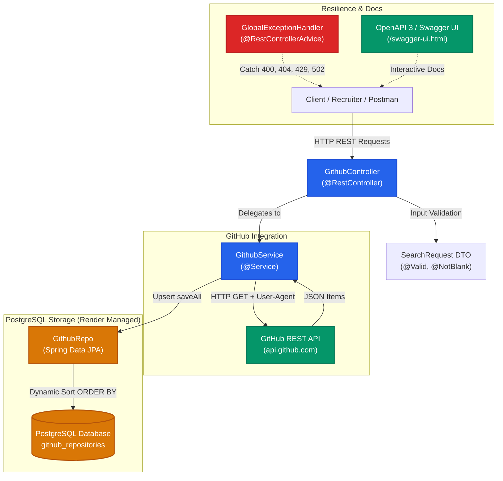
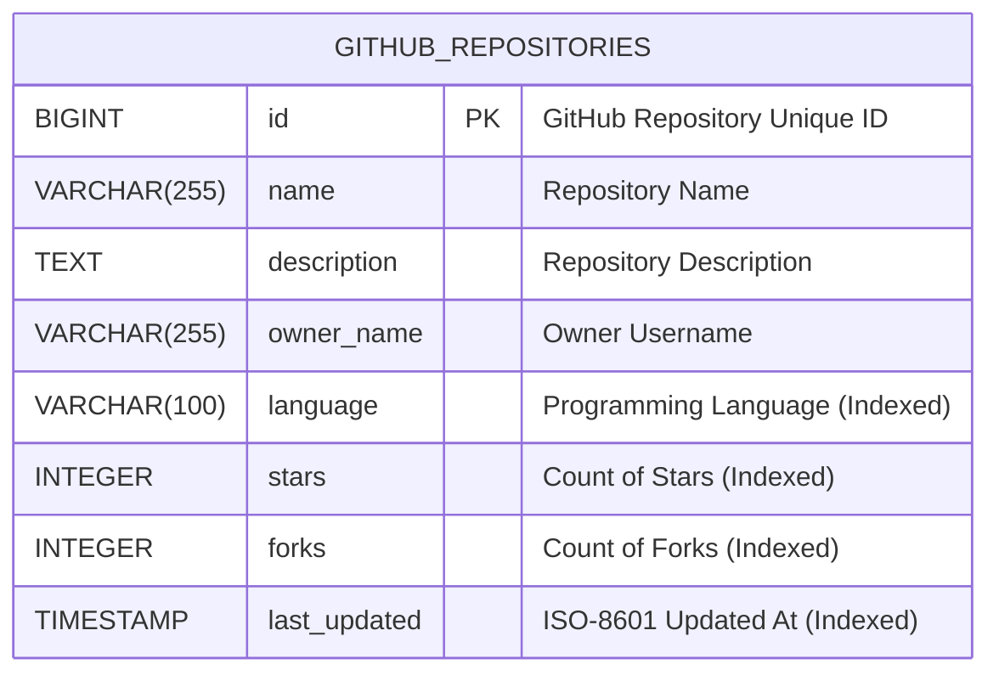
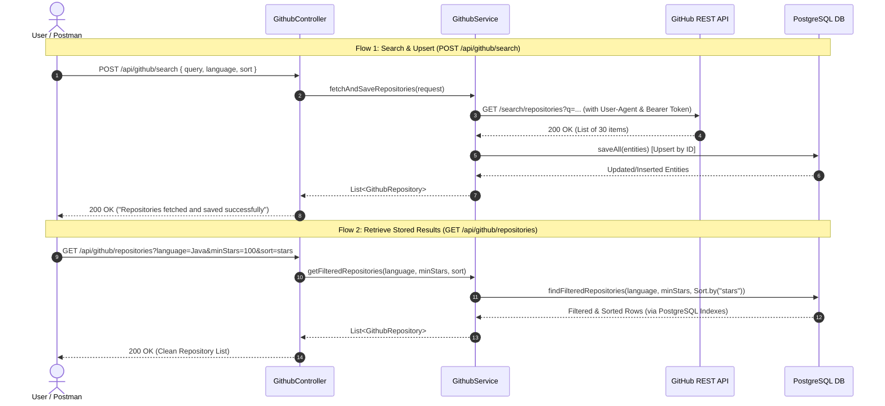

# GitHub Repository Searcher & Manager — Architecture & Schema

## 🏗 High-Level System Architecture

---

## 🗄 PostgreSQL Database Schema (`github_repositories`)

### ⚡ Performance Indexes:
- `idx_github_repositories_language` ON `language`
- `idx_github_repositories_stars` ON `stars`
- `idx_github_repositories_forks` ON `forks`
- `idx_github_repositories_last_updated` ON `last_updated`

---

## 🔄 End-to-End Execution Flow

